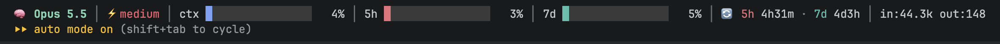

# claude-code-statusline

A compact, colorful status line for [Claude Code](https://code.claude.com/docs/en/statusline) that shows your model, reasoning effort, context usage, 5-hour and weekly rate limits, and token counts.



## Features

- **Context bar**: how much of the context window is used.
- **5-hour limit bar**: how much of the 5-hour rate limit is used.
- **Weekly limit bar**: how much of the 7-day rate limit is used.
- **Reset timers**: time until each limit resets, e.g. `2h11m` or `3d11h`.
- **Tokens**: input and output tokens in the current context window, formatted as `950`, `48.2k`, or `1.2M`.
- **One bar style**: all three bars fill up as you spend, so a fuller bar always means less headroom. Switch all of them to draining with one setting.
- **Fast**: a single `jq` call per render, no network requests, no git calls.
- **Graceful fallback**: missing fields render as `n/a` instead of breaking the line.
- Easy customization

## Installation

1. Download the script and make it executable:

   ```bash
   curl -fsSL https://raw.githubusercontent.com/antonchupak/claude-code-statusline/main/statusline.sh \
     -o ~/.claude/statusline.sh
   chmod +x ~/.claude/statusline.sh
   ```

2. Add the `statusLine` block to `~/.claude/settings.json`:

   ```json
   {
     "statusLine": {
       "type": "command",
       "command": "~/.claude/statusline.sh",
       "refreshInterval": 60
     }
   }
   ```

   `refreshInterval` re-runs the script every 60 seconds, so the reset timers stay current while the session is idle. Without it, the line only updates on session events.

3. Start a new prompt in Claude Code. The status line appears above the footer.

## Data sources

The script reads the JSON that Claude Code sends to the status line on stdin:

| Segment | JSON field |
| --- | --- |
| Model | `model.display_name` |
| Effort | `effort.level`, fallback `thinking.enabled` |
| Context bar | `context_window.used_percentage` |
| 5h bar / timer | `rate_limits.five_hour.used_percentage`, `rate_limits.five_hour.resets_at` |
| 7d bar / timer | `rate_limits.seven_day.used_percentage`, `rate_limits.seven_day.resets_at` |
| Tokens | `context_window.total_input_tokens`, `context_window.total_output_tokens` |

Note: token counts reflect what is currently in the context window, taken from the most recent API response. Input includes cache reads and writes. They are not cumulative session totals.

See the [official status line docs](https://code.claude.com/docs/en/statusline) for the full list of fields.

## Uninstall

Remove the `statusLine` block from `~/.claude/settings.json` (or run `/statusline delete` in Claude Code), then delete `~/.claude/statusline.sh`.

## License

MIT